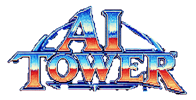
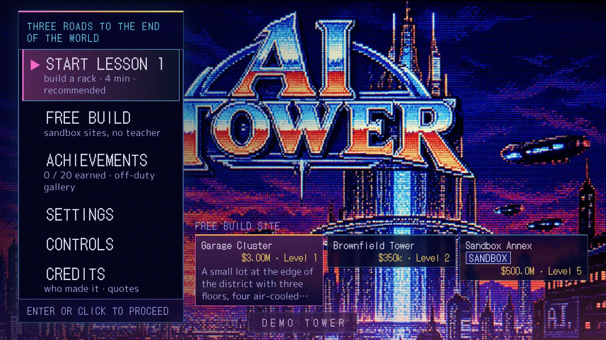
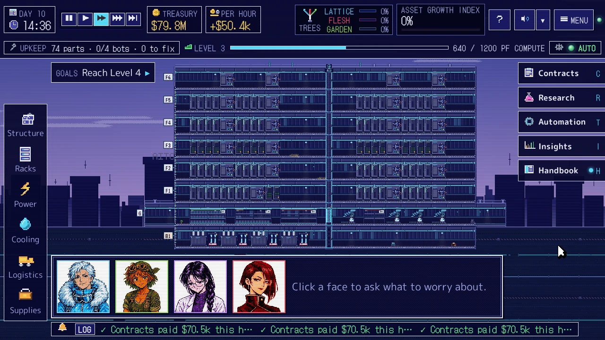
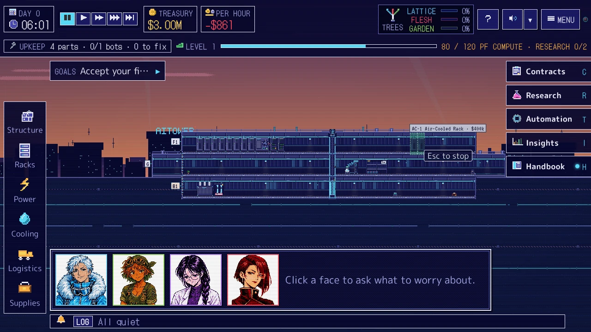
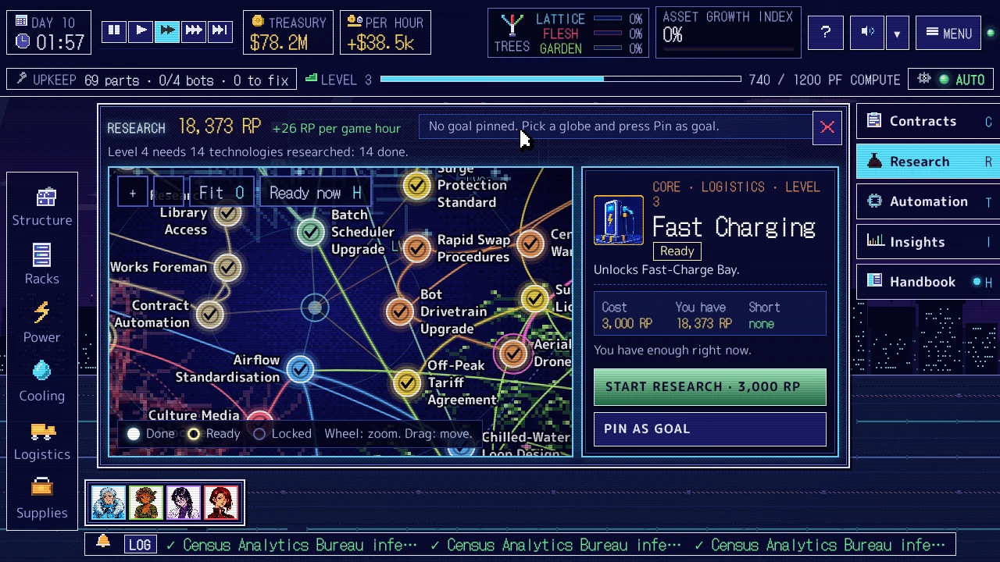
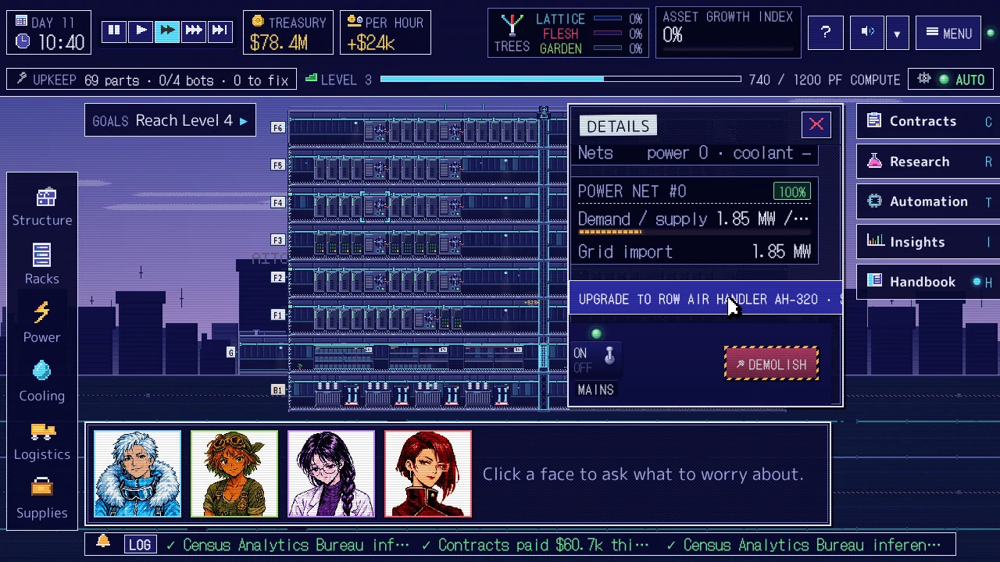
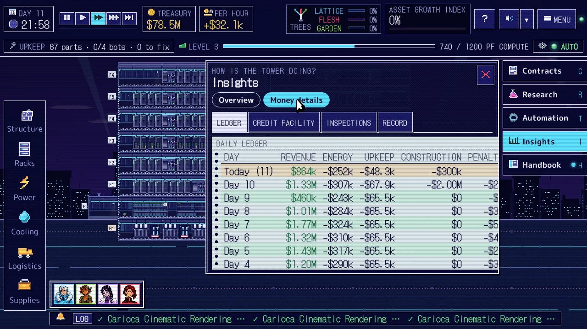

<h1 align="center"></h1>

**Three ways to end the world.**

Midnight-indigo pixels, a dreamy synth soundtrack, a lift ride away from 1998.
Your advisors argue. You decide.

## How to play

- **Play in your browser:** (link coming)
- **Single file:** download `AItower.html` and open it. Code, art, fonts and music are all inside that one file; no install, no server. Saves live in that browser.
- **From source:** `npm ci`, then `npm run dev` and open the printed URL. `npm run build:single` makes the single file; `npm run build:site` assembles the website (with the game at `play/`) into `site-dist/`.

## Features

- Stack floors of a vertical AI datacenter in a 2D side-cut pixel-art tower.
- Route power, coolant and service lifts; keep repair bots swapping failed GPUs.
- Sell compute to contracts and watch the money, heat and uptime.
- Four advisors with strong opinions and visual-novel scenes.
- A research map to grow your tower in different directions.
- A synth soundtrack and PC-98 look, with CRT scanlines.

## Credits

Code by Claude. Art generated with ChatGPT; some sprites by Claude. Inspired by SimTower; nothing borrowed. Quotes credited in game. Design by Perry.

[Support on Ko-fi](https://ko-fi.com/50866)

## Development

`npm run check` runs typecheck, module boundaries, lint and tests. Architecture: [`docs/ARCHITECTURE.md`](docs/ARCHITECTURE.md). Handoff notes: [`docs/dev/HANDOFF.md`](docs/dev/HANDOFF.md). Look: [`docs/STYLE_PC98.md`](docs/STYLE_PC98.md).

## Licence

MIT License. See [`LICENSE`](LICENSE).
